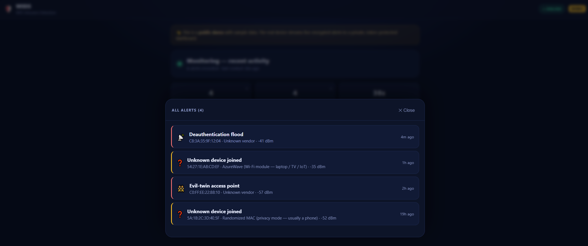
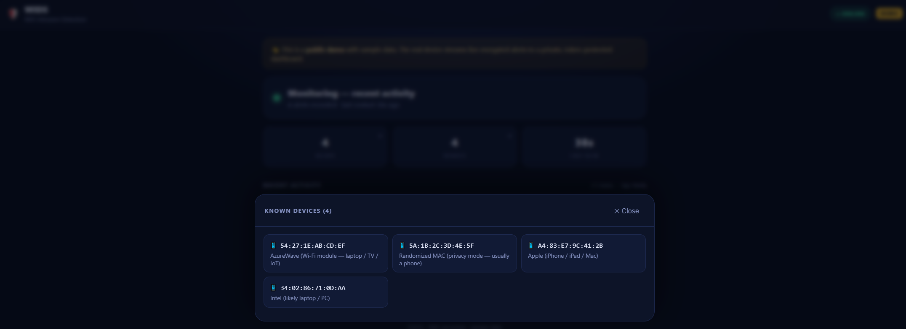
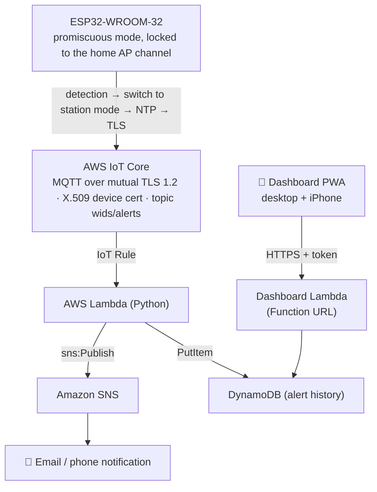

# 🛡️ WiFi Intrusion Detection System (WIDS)

**A passive WiFi security monitor on a single ESP32 that detects deauthentication attacks, evil-twin
access points, and unknown devices joining your network — then delivers encrypted,
certificate-authenticated alerts to your phone through AWS. Runs at $0/month.**


<p align="center"></p>

---

## What it does

| | Detection | How |
|---|---|---|
| 📡 | **Deauthentication / disassociation floods** | Sniffs 802.11 management frames in promiscuous mode; flags floods by frame-control signature (`0xC0`/`0xA0`), filtered to your own AP's BSSID |
| 👯 | **Evil-twin / rogue access points** | Baselines your SSID→BSSID map at boot, then rescans; alerts when your network name appears under an unknown BSSID |
| ❓ | **Unknown devices joining** | Watches 802.11 association frames, learns your devices (persisted to flash), alerts on an unrecognised MAC |

When something is detected, the device switches out of monitor mode, connects, and publishes an
**encrypted MQTT alert over mutual TLS** to AWS IoT Core — which triggers a serverless pipeline that
**emails you** and records the event for the **dashboard app**.

---

## 🎬 See it in action

<p align="center">
  
</p>

<p align="center"><em>One ESP32 detects an attack → encrypted, certificate-authenticated alert through AWS → notification on your phone.</em></p>

---
## 📱 The dashboard app

A **PWA** that runs in any desktop browser and — via Safari's *Add to Home Screen* — like a native app
on iPhone. No App Store, no hosting, no API Gateway: a single Lambda Function URL serves both the page
and its (token-protected) data.

Shows a live **ONLINE/OFFLINE** sensor badge and the **3 most recent alerts** — each MAC annotated
with a best-effort **manufacturer hint** (Apple / Intel / Samsung…) and a flag for **randomized
"private" MACs**. Two tappable cards open the full history: **Alerts** (every recorded alert) and
**Devices** (your complete saved-device list).

<p align="center">
  
</p>
<p align="center">
  
  
</p>

Setup: [docs/DASHBOARD-APP.md](docs/DASHBOARD-APP.md)

---

## Architecture



Everything server-side is **serverless**, in one region (`eu-central-1`), with **no VPC, no NAT
gateway, no EC2** — which is what keeps it free.

---

## Quick start

| Step | Guide |
|---|---|
| 0. Make sure AWS can't charge you | [docs/COST-SAFETY.md](docs/COST-SAFETY.md) |
| 1–7. Build it milestone by milestone | [docs/SETUP.md](docs/SETUP.md) |
| Device identity (X.509 certs) | [cloud/aws-iot-setup.md](cloud/aws-iot-setup.md) |
| Email alert pipeline | [cloud/cloud-alerting-setup.md](cloud/cloud-alerting-setup.md) |
| Hardening + heartbeat/offline alarm | [docs/HARDENING.md](docs/HARDENING.md) |
| Dashboard app | [docs/DASHBOARD-APP.md](docs/DASHBOARD-APP.md) |

You need: an **ESP32-WROOM-32**, a USB data cable, and a free AWS account. That's it.

---

## Repository structure

```
firmware/
  WIDS_ESP32/          main device sketch (detection + encrypted alerting)
  M1_hello_esp32/      milestone 1: board bring-up test
  M2_deauth_detector/  milestone 2: standalone deauth detector
cloud/
  iot-policy.json      least-privilege AWS IoT policy
  lambda/              alert handler (email + history + liveness metric)
  lambda-dashboard/    dashboard Lambda (serves the PWA + JSON API)
  *-setup.md           click-by-click AWS console guides
webapp/index.html      the dashboard PWA (readable source)
webapp/demo/           public sample-data demo (deploy to Vercel / GitHub Pages)
docs/                  setup, cost safety, hardening, security review, portfolio notes
docs/architecture.svg  architecture diagram · docs/demo-animation.html  animated explainer
```

---

## Security

This project is built with real security practices, and reviewed like one:
- **Mutual TLS** with a per-device **X.509 certificate** (not a shared password)
- **IAM least-privilege** everywhere — the device may only connect as one client ID and publish to one
  topic; each Lambda role is scoped to a single action
- **No secrets in git** — credentials live in a git-ignored `secrets.h`; the private key never leaves
  the device

A full threat model, findings list, and hardening roadmap: **[docs/SECURITY-REVIEW.md](docs/SECURITY-REVIEW.md)**

---

## Honest limitations

Stated up front, because overclaiming is how security tools lose trust:
- **2.4 GHz only** — the WROOM-32 has no 5 GHz radio.
- **One channel at a time** — it locks to the home AP's channel; off-channel activity isn't seen.
- **Brief blind window** (~1–10 s) while switching to send an alert — it reports attack *episodes*,
  not every frame.
- **Management frames only** — data payloads are WPA2-encrypted and unreadable (which is exactly why
  deauth/evil-twin detection works without your password).
- **PMF/802.11w** — on networks enforcing Protected Management Frames, classic deauth attacks don't
  work, so there's less to detect.
- **MAC randomization** makes unknown-device detection noisier than deauth detection.

---

## Cost

**$0/month.** The project runs inside AWS's always-free tiers (Lambda, SNS email, basic CloudWatch,
DynamoDB) plus IoT Core's free tier. Cost guardrails and the full breakdown:
[docs/COST-SAFETY.md](docs/COST-SAFETY.md).

---

## ⚖️ Ethical & legal note

This is a **passive, defensive** monitor for **your own** network. Any active testing (e.g. generating
deauth frames to verify detection) must be performed **only against equipment you own**. Attacking
networks you don't own is illegal.

---

## License

[MIT](LICENSE)
