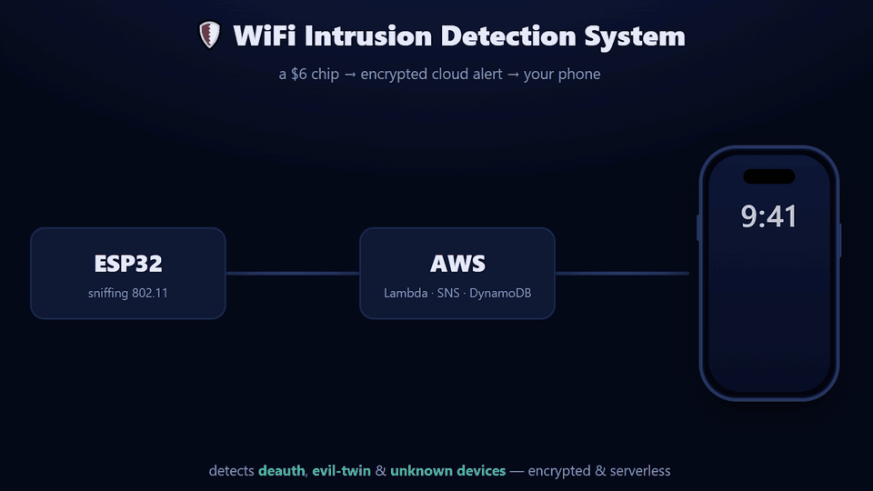
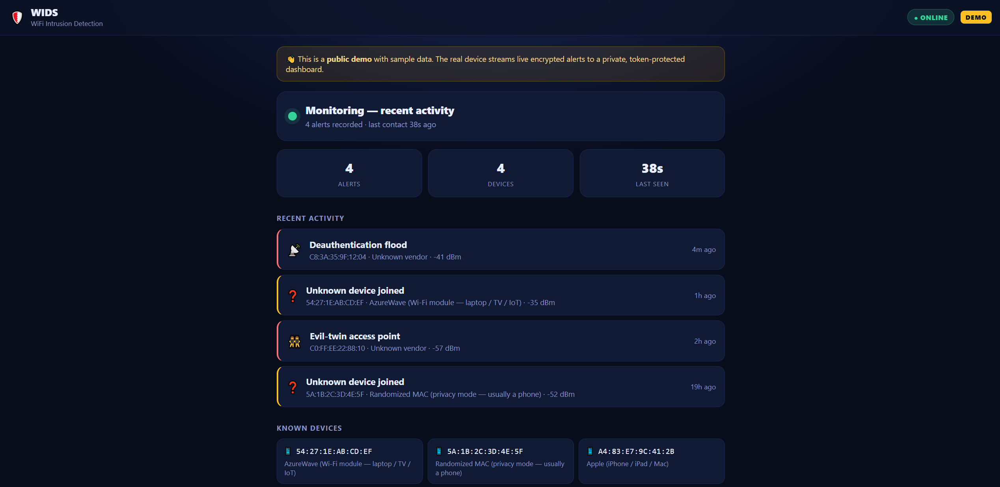
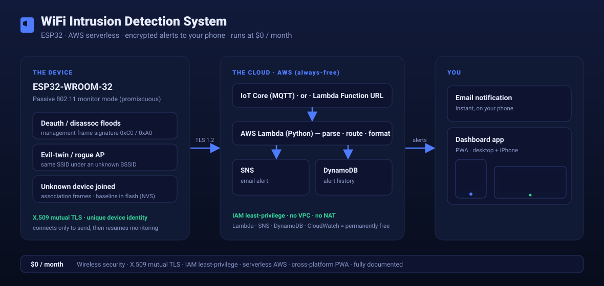

# WiFi Intrusion Detection System

A $6 ESP32 chip that watches a Wi-Fi network for attacks and sends an encrypted alert to a phone
through AWS, within seconds. It runs on the AWS free tier, so it costs $0 a month.

**Live demo: [wids-demo.vercel.app](https://wids-demo.vercel.app)** (sample data)

  

## What it does

I built it to watch my own home network. It warns about three things:

- Someone knocking devices off the Wi-Fi (a deauthentication attack).
- A fake copy of the network with the same name (an evil-twin access point).
- A device the system has never seen before joining the network.

Each alert goes to an email and to a dashboard that works on a computer and on an iPhone.

  

## How it works

- The ESP32 listens to Wi-Fi management frames, which are never encrypted, even on WPA2. It does not
  need the Wi-Fi password to see these attacks.
- When it detects one, it connects for a moment and sends the alert over MQTT with mutual TLS, using
  its own X.509 certificate, to AWS IoT Core.
- AWS Lambda sends the email (Amazon SNS) and stores the alert (DynamoDB). A second Lambda serves the
  token-protected dashboard.
- Everything on AWS is serverless and inside the free tier. Each part may only do its one job
  (least-privilege IAM). The full threat model is in [docs/SECURITY-REVIEW.md](docs/SECURITY-REVIEW.md).

## Build your own

You need an ESP32-WROOM-32, a USB data cable and a free AWS account.

| Step | Guide |
|---|---|
| Make sure AWS cannot charge you | [docs/COST-SAFETY.md](docs/COST-SAFETY.md) |
| Build it step by step | [docs/SETUP.md](docs/SETUP.md) |
| Device certificate and policy | [cloud/aws-iot-setup.md](cloud/aws-iot-setup.md) |
| Email alerts | [cloud/cloud-alerting-setup.md](cloud/cloud-alerting-setup.md) |
| Dashboard app | [docs/DASHBOARD-APP.md](docs/DASHBOARD-APP.md) |
| Hardening and the sensor-offline alarm | [docs/HARDENING.md](docs/HARDENING.md) |

Your Wi-Fi details and the device keys go in `firmware/WIDS_ESP32/secrets.h`, which git ignores.
Copy `secrets.example.h` to start.

## Limits

- 2.4 GHz only, and one channel at a time (the channel of your own router).
- While it sends an alert it stops listening for a few seconds, so it reports attack episodes,
  not every frame.
- Networks with Protected Management Frames (WPA3, 802.11w) already block the classic
  deauthentication attack, so there is less to detect.
- Phones that change their Wi-Fi address (MAC randomization) can show up as new devices.

## Use it on your own network only

It only listens; it never attacks. If you test it by sending attack frames, do that only against
equipment you own.

## License

[MIT](LICENSE)
